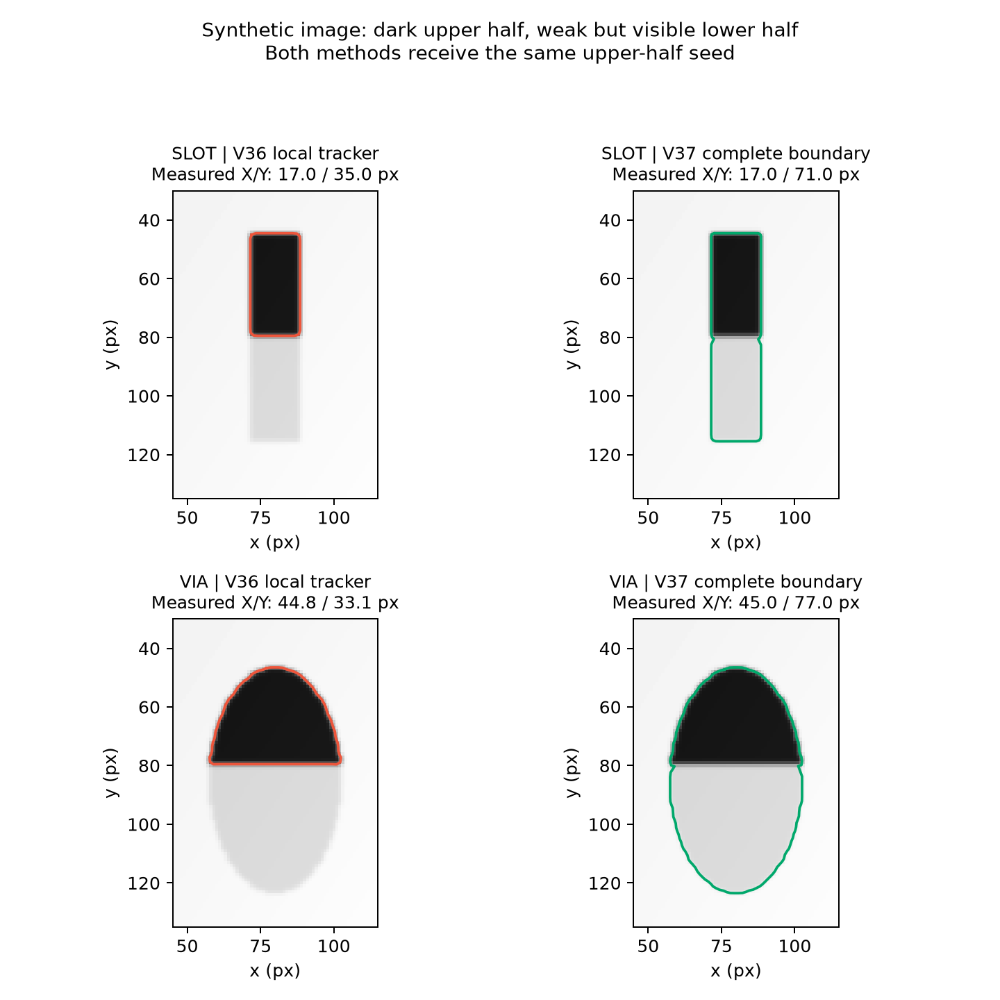

# 2026-10-15：V37 完整轮廓复核与弱图案补检

- 状态：代码、完整说明、验证与 ZIP 已完成
- 基于版本：V36（SEM_0830_0831_compare_V36_bundle）
- 目标版本：V37（SEM_0830_0831_compare_V37_bundle）
- 目的：改善 slit/via/trench 漏检，以及轮廓只覆盖上半部、在真实外边缘之前闭合成锯齿的问题。

## 具体改动

- `SEM_0830_0831_compare_V37_bundle/sem_before_after_compare_0831_V37.py`：独立 V37 入口、版本与输出文件名；保留 single/compare、原图比例尺、六项指标、均值 ± SD、V36 的非圆形貌/局部缺失规则和每图最多 300 秒时限。
- 原精细追踪函数内容保留为 `_v32_supported_contour_legacy`（AST 对比确认实现不变），新增 `_v37_supported_contour` 包装：检查轮廓外侧是否仍有明显前景，必要时先在原图有界窗口重找完整连通区域，再执行原图 50% 灰度法线追踪。修正“局部支持率 100%，但实际只测到内部明暗台阶”的情况。
- 局部窗口保留额外背景留白；候选保留至少 60% 原种子核心、定位面积为原种子 0.65–4.5 倍，不允许贴窗口边缘。多档噪声/响应阈值覆盖明暗不均。最终轮廓仍须原有 85% 支持及连续缺边限制；外侧仍有未解释前景、重定位失败时记录 `UNRESOLVED_OUTER_BOUNDARY` 并拒测。
- `_v37_feature_candidates`：每张 slit/via 图执行多尺度局部对比候选补充，即使已有其他有效对象也继续；via 在尺度估计前合并候选，slit 在四排定位前合并。最终仍执行原图、形貌和阵列检查。
- trench 新增原图局部条体响应、独立上下体证据、完整纵向包络及局部灰度平台 50% 端点。保留平均上下宽度、坐标轴投影、用户尺寸范围和标注结构；不优先追随最强内部灰度台阶、不将全图中位端点直接复制给各列。
- 新增 `boundary_*` 追溯字段与 `measure_v37_*` 计数，settings 保存完整性、候选、区域限制和 trench 平台规则；完整性标记不是准确率标记。
- 包内 `README_V37.txt` / `ALGORITHM_V37.md`：完整使用说明、修复原理、输入与输出、边界和验证范围；requirements 继承 V36，未新增依赖。
- `tests/test_v37_edges.py`：11 项完整边缘/局部弱图案/trench/真实 CLI 测试；`tests/test_v37_morphology.py` / `tests/test_v37_workflows.py`：27 项继承场景实际加载 V37。新版本直接验证共 38 项，历史测试文件保持原样。
- `md/figures/2026-10-15_V37_boundary-recovery.png`：从新测试的 `partial_feature` 合成场景生成并实际查看的边缘模块对照；两种方法使用同一上半轮廓种子，并非真实 SEM 或整个 V36 流水线的准确率对比。图片仅作为仓库修改证据，不是运行依赖。
- 更新根 `README.md` 与 `md/README.md`，保留所有历史目录和 ZIP。

## 验证

- 开始时工作区干净；`git fetch origin` 后快进检查为 Already up to date；扫描最新源码/ZIP 为 V36，建立 V37。
- 环境：既有 `/tmp/compare-v35-venv/bin/python`，Python 3.12 与完整 requirements；使用 `PYTHONDONTWRITEBYTECODE=1`、`MPLBACKEND=Agg`、`MPLCONFIGDIR=/tmp/compare-v37-mpl`、`OPENBLAS_NUM_THREADS=1`。
- 首次 V37 针对性验证：`python -m unittest discover -s tests -p 'test_v37*.py' -v`，38 项运行 171.877 秒，其中 37 项通过、1 项明暗不均 slit 场景失败。
- 定位该失败：初始种子只覆盖约一半 slit，原区域窗口的下边缘距离真正低对比末端太近，造成候选触边/背景估计偏差；增加 8 px 背景留白，并在强度跨度大的场景补充较低的中间阈值。原失败项单独复核通过（0.490 秒），修正进入最终完整回归。
- 受控半轮廓复现：真实 slit 约 17×71 px，旧局部追踪输出约 17×35 px；真实 via 约 45×77 px，旧输出约 44.8×33.1 px，两者旧局部支持率均为 100%。新流程测回完整跨度；弱下半部及明亮极性纳入验证。实际短对象保持原长度，不凭模型向下延长。
- 原图空白/倾斜背景即使有形状定位种子也拒测；明显不规则真实外轮廓不会替换成椭圆后进入统计。
- 明暗不均阵列：20 个 via（含一个整体很弱的孔及其他上深下浅孔）验证完整约 41×41 px 与去重；slit 验证 3 个最下排对象约 17×21 px。
- trench 合成场景包括内部灰度台阶、弱下条、强弱条交替，每场保留 9 对，宽度约 20 px、端点约 170/230 px、真实间隙约 60 px；明亮极性、PixelSize=2、显式尺寸提示验证约 40 nm 宽度 / 120 nm 间隙。空白、噪声背景及只有上条时均拒测。
- 真实 CLI/独立 worker 测试以 PixelSize=2 运行三类明暗不均图片：32 个有效对象、18 张统计图，检查完整尺寸、标注、CSV/XLSX、settings 及原图信号来源。
- 第一次完整回归在历史 V32 测试处以 SIGTERM（退出码 143）中断，未得到完整汇总，不能记作通过。停留的历史测试单独运行通过：`test_v32.CDPolicyTests.test_via60_above_old_cd_ceilings_keeps_actual_boundaries`，20.837 秒（进程总计 23.36 秒）。
- 最终完整回归并持续读取输出：`PATH=/tmp/compare-v35-venv/bin:$PATH PYTHONUNBUFFERED=1 PYTHONDONTWRITEBYTECODE=1 PYTHONHASHSEED=0 OMP_NUM_THREADS=1 MPLBACKEND=Agg MPLCONFIGDIR=/tmp/compare-v37-mpl OPENBLAS_NUM_THREADS=1 python3 -m unittest discover -s tests -v`；通过 `tee` 保存 `/tmp/compare-v37-regression-final.log`，启用 pipefail。**205 项全部通过，509.393 秒**，包含历史 167 项及 V37 38 项；进程退出码 0。最终源码通过后仅更新说明中的结果记录。
- Python 语法、最终文档链接（含 ZIP）、新增文件空白及 `git diff --check` 检查通过。
- 未验证事项：尚未收到本次问题的真实 SEM 原图、同名 TXT 和当前标注；目前是合成复现及流程验证，不代表实际漏检已全部修复。严重相连污染、极低对比、大段边缘缺失、未知构图仍可能拒测或需结合原图调整。Windows/macOS 原生运行未在本机验证。

## 交付

- ZIP：`SEM_0830_0831_compare_V37_bundle.zip`，200068 字节。
- 明确发布清单为主脚本、requirements、完整 README 和 ALGORITHM，共 4 文件，位于同名顶层目录；无虚拟环境、缓存、密钥、测试数据及临时输出。
- ZIP CRC 完整性检查及实际解压后的逐文件二进制对比全部通过。
- SHA256：`dc38a89b00b34a91ce38498e9ba89f0a9c471867c6ed83f1f0498a73cc8802bf`。
- 合成对照 PNG：`md/figures/2026-10-15_V37_boundary-recovery.png`（仓库文档附件，157997 字节，不是运行依赖，未放入 ZIP）。
- GitHub 目标：`git@github.com:Qiaochu-Zhang/compare.git` 的 `main` → `origin/main`，沿用已有 SSH 配置。
