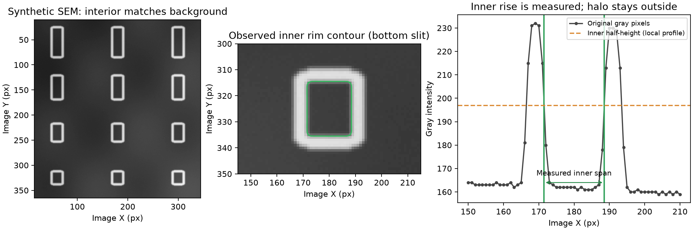

# 2026-10-16：V40 孔槽亮边识别

- 状态：代码、说明、完整回归及 ZIP 交付校验已完成
- 基于版本：V39（796d6a1，`SEM_0830_0831_compare_V39_bundle`）
- 目标版本：V40（`SEM_0830_0831_compare_V40_bundle`）
- 目的：孔槽内部与背景相近时，用外圈亮边定位，重点增强 slit，同时保留原图测量与阵列审核。

## 开始状态与定位

- main → origin/main 工作区干净，已有 SSH 配置沿用；`git fetch origin` 与 `git merge --ff-only @{upstream}` 成功，源码目录及 ZIP 最大整数版本均为 V39。
- V39 主要按内部/外部明暗分割；亮边很细时，常规法线两侧带可能错过亮峰，四排候选也可能被弯曲背景的碎片干扰。
- 使用细弱一像素亮圈（内部/背景同色、亮边增量 12 灰度、弯曲背景幅度 20、噪声 0.3）的真实主选择函数复现：V39 首轮 0 个，V40 首轮 3 个最下排 slit。
- 本批真实 SEM 原图/TXT 不在仓库中；所有新识别结果为受控合成验证，不代表真实样品召回率或工艺尺寸准确度。

## 具体改动

- `SEM_0830_0831_compare_V40_bundle/sem_before_after_compare_0831_V40.py`：从 V39 四文件发布清单复制建立独立 V40；更新主脚本、`main_v40`、`V40DetectionOptions`、默认目录/工作簿、版本与算法标识和本版终端文案。历史函数和 v39 恢复字段保留实际来源。
- `_v40_bright_rim_candidates`：从原始测量灰度做 5–65 px 多尺度 top-hat；以亮圈内孔建立候选，3×3 闭合只帮助微小断点定位。最多审核 240 个、保留 120 个候选，每个均接受原图审核。
- `_v40_supported_rim_contour`：原图法线同时检查内侧上升、亮峰和外侧回落；峰值须超过内/外参考至少 max(4 灰度,5×噪声)。在内部参考到亮峰之间取内侧 50% 交点，不测外圈光晕或峰中心线。保留 ≥85% 支持、≤8% 连续缺边和轮廓变化边界，小缺口只连接实测端点。
- slit 首轮融合亮圈内沿并保留普通定位/补检；同位置优先使用已通过原图亮峰审核的内沿；首轮未接纳的亮圈仍可补充，已有暗槽成功时也有效。继续只统计受支持列最下排，不补造缺失轮廓。
- 充分重复的亮圈独立建立四排、列距/相位后，其他候选须符合实测格位且轮廓不能跨半格边界；冲突记录 `slot_outside_bright_rim_grid`。受控纹理图曾出现 2 个宽大背景伪候选，新增审核将其剔除，保留真实 3 个最下排。
- via 亮圈内沿进入整体观测轮廓路径，继续执行形貌、二维阵列、格位、去重和最终用户限制。显式提示/可靠首轮尺度保留；只有重复亮圈确能提供可靠尺度时才使用 `V40_bright_rim_scale`，单个亮圈不覆盖普通补充尺度。
- 保留严格 V39 四孔零结果启动，补充候选不足四个时可将真实亮圈送入继承的 L3/L4 主流程；最终少于四个仍不能启动 2×2。
- 新增对象、状态和 settings 亮边来源/数量/口径审计。实际亮边测量的两个置信字段为 `BRIGHT_RIM_REVIEW`；原恢复标记仍保留。single/compare、统计、nm、显式限制和共享 300 秒硬时限继续工作。
- `tests/test_v40_bright_rim.py`：20 项直接加载 V40 的亮边、尺寸、误检边界、缺失/混合阵列、参数与真实 worker/导出验证。
- `tests/test_v40_recovery.py`：14 项直接加载 V40 的 V39 零结果恢复、原有弱/弯曲/密集/椭圆及 slit 能力回归。
- `tests/test_v40_workflows.py`：14 项实际用于 V40 的 single/compare、统计/作图/Excel、auto、真实 CLI/worker 和超时回归。
- V40 README、算法说明、根 README、md 索引和本记录同步；新增 `md/figures/2026-10-16_V40_bright-rim.png` 解释内沿口径。requirements 与 V39 逐字节相同，无新增依赖。

## 合成示意

- 图仅用于解释测量口径，12 个亮圈均从原图审核；中间绿色轮廓为最下排 slit 的内侧半高边界，孔内跨度约 17.03 px，外圈亮峰/光晕不作为尺寸。

## 验证

- 环境：`/tmp/compare-v40-venv`，Python 3.12；依赖 numpy 2.5.4、pandas 3.0.6、scipy 1.18.1、opencv-python 5.0.0.93、matplotlib 3.11.2、openpyxl 3.1.5。
- 统一环境变量：`PATH=/tmp/compare-v40-venv/bin:$PATH OPENBLAS_NUM_THREADS=1 PYTHONDONTWRITEBYTECODE=1 MPLBACKEND=Agg MPLCONFIGDIR=/tmp/compare-v40-mpl`，避免发布目录产生缓存。
- 初次继承能力测试 14 项通过，237.867 秒；日志 `/tmp/compare-v40-recovery.log`。
- 首轮新增测试 17 项中 15 项通过、2 项失败：异常相接亮圈会产生小间隙定位候选，因此改为要求完整 via 流程拒测；13 px 开口在长 slit 上仍可能满足允许的缺边比例，因此将“大缺口拒测”改为实际 25 px 开口。未放宽生产边缘或形貌门槛。修正后相关 2 项通过，28.154 秒；日志 `/tmp/compare-v40-shape-targeted.log`。
- 强纹理伪候选与 V39 零结果对照 2 项通过，21.342 秒；日志 `/tmp/compare-v40-grid-targeted.log`。
- 补充“单个孤立亮圈不替换普通重复孔径”验证 1 项通过，10.556 秒；日志 `/tmp/compare-v40-scale-targeted.log`。
- V40 专项：`python3 -m unittest discover -s tests -p 'test_v40*.py' -v`，启动时的 47 项全部通过，408.142 秒；另补上述独立尺度验证 1 项，共 48 项直接验证通过。专项运行中补充了尺度来源审计，最终全仓库回归包含所有最终代码与 48 项验证；日志 `/tmp/compare-v40-targeted-final.log`。
- 最终全仓库回归：`MPLBACKEND=Agg python3 -m unittest discover -s tests -v`（上述统一环境），**336 项全部通过，1248.800 秒，其中 48 项直接加载 V40**；退出码 0，日志 `/tmp/compare-v40-regression.log`。包括最终代码、尺度来源审计、真实 CLI/worker/auto 及超时。
- AST 语法检查通过；requirements 与 V39 逐字节相同。AST 按所有同名重定义逐项对比确认 12 个关键算法未改：传统原图追踪、V37 完整性/搜索、V38 slit/via 局部背景/连续性、via 形貌、所有 trench 主测量与配对、V39 严格四孔与零结果试验控制。
- V40 `--help`、AST 语法和源目录尾部空白检查通过；`git diff --check` 已通过。发布 ZIP 和最终 Markdown 链接在下方交付中记录。
- 未验证：真实 SEM 召回率/误检率及物理尺寸标定、Windows/macOS 原生运行。

## 交付

- ZIP：`SEM_0830_0831_compare_V40_bundle.zip`，214409 字节，同名顶层目录。
- 明确发布四文件：`sem_before_after_compare_0831_V40.py`、`requirements.txt`、`README_V40.txt`、`ALGORITHM_V40.md`；不包含缓存、虚拟环境、测试数据或无关文件。
- ZIP CRC 完整性检查通过；归档条目与四文件清单一致；实际解压后每个文件与源码逐字节一致。校验报告 `/tmp/compare-v40-package-check.json`。
- SHA256：`8677fcad27986ab136c6013e8d5a92148feb30941f59ac69067e393c96a3e1c0`。
- 根 README、md 索引/记录及 V40 算法文档的本地 Markdown 链接均检查有效，发布目录和文档无尾部空白。
- GitHub 同步目标：git@github.com:Qiaochu-Zhang/compare.git，main → origin/main；发布提交包含本记录、V40 四文件、ZIP、三份直接测试、合成示意图、根 README 和索引。提交 ID 及推送后远端一致性核对结果见交付回复。
